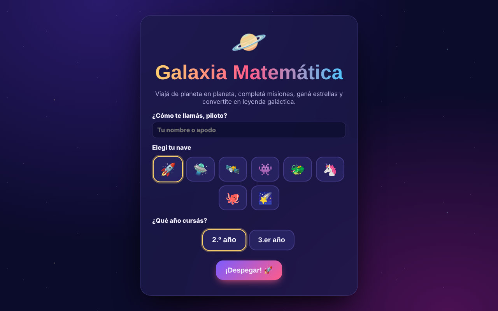

# 🪐 Galaxia Matemática

> Gamified math learning app for secondary school (2nd–3rd year, Córdoba curriculum): theory, interactive simulators, auto-generated practice and arcade games.

    



## Overview
Each curriculum block is a **planet** and each topic is a **mission**. Students learn, practice and play without creating accounts; progress is stored locally in the browser. Built for my own 2nd- and 3rd-year students.

## Key features
- **8 planets / 35 missions** covering integers, algebra, rationals, geometry, statistics, Pythagoras, trigonometry and linear functions.
- **Interactive simulators**: equation balance, quadrilateral explorer, Pythagoras, trigonometry, function grapher.
- **Procedurally generated practice**: 10 random exercises per mission with automatic grading and explanations — never the same set twice.
- **Games**: *Asteroid Rain* and *Time Trial*, plus a mixed challenge per planet.
- **Gamification**: XP, ranks, 12 achievements, stars, sound effects, mobile mode.
- **Teacher tools**: one click prints a worksheet with 12 fresh exercises and a separate answer key.

## Tech stack
Vanilla JavaScript (ES modules) bundled with **esbuild** into a single IIFE, plain CSS, no backend. Works offline from `index.html`.

## Run locally
```bash
# open index.html directly, or:
python3 -m http.server 8080
```
Rebuild the bundle after editing `js/`:
```bash
npx esbuild js/app.js --bundle --format=iife --minify --outfile=js/galaxia.bundle.js
```

## Deploy
Static site — Netlify Drop, Netlify from Git, or GitHub Pages. `netlify.toml` included.

📘 Detailed guide (Spanish): [docs/GUIA.md](docs/GUIA.md)

---

## Author

**Guillermo Cuenya** — Senior QA Automation Engineer / SDET · Telecommunications Engineer  
[LinkedIn](https://www.linkedin.com/in/guillermoadriancuenya/) · [GitHub](https://github.com/gcuenya1)
